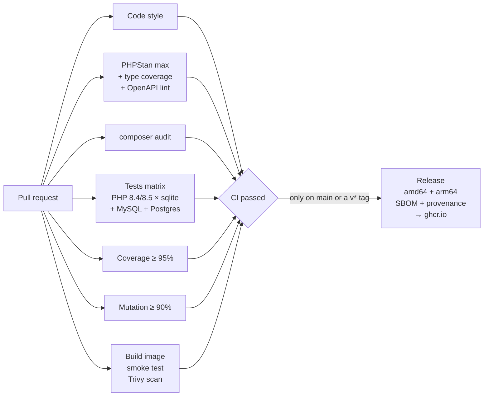

# Tally

[](https://github.com/GodfreysDragon/tally/actions/workflows/ci.yml)


[](LICENSE.md)

**A small invoicing API that exists to show how I test and ship software.**

The app is deliberately modest: customers, invoices, payments, signed webhooks, overdue reminders. What this repo shows is the pipeline around it. Every pull request has to pass every gate below before it can merge, and only a fully green commit on `main` produces a signed, multi-arch container image.

```
278 tests · 739 assertions · PHP 8.4 + 8.5 · SQLite, MySQL 8.4, Postgres 17
100% line coverage · 100% type coverage · PHPStan level max
377 / 377 mutants detected (100% mutation score)
every API response checked against the OpenAPI spec
```

Every number above comes from CI, not from a laptop. That distinction mattered: see [what the first real CI run caught](#what-the-first-real-ci-run-caught).

---

## The quality gates

| Gate | Tool | Threshold | Why it's there |
|---|---|---|---|
| Code style | Pint | zero diffs | Style isn't a review topic. |
| Static analysis | PHPStan + Larastan | **level max**, no baseline | Catches whole classes of bugs before a test runs. |
| Type coverage | Pest type-coverage | **100%** | Every parameter, property and return is typed, so PHPStan has something to check. |
| Architecture | Pest `arch()` | 14 rules | Conventions are enforced by the build, not by reviewers. |
| Tests | Pest | PHP 8.4 + 8.5 × SQLite, MySQL 8.4, Postgres 17 | SQLite is fast; the real databases catch what SQLite forgives. |
| Line coverage | Pest + PCOV | **≥ 95%** | A floor, not a target. See mutation testing. |
| Mutation testing | Pest `--mutate` | **≥ 90%** score | Coverage says a line *ran*. Mutation testing says a test would *notice* if it were wrong. |
| API contract | [OpenAPI spec](docs/openapi.yaml) + league/openapi-psr7-validator, Redocly | every response matches | The docs can't drift from the API, because every API response in the suite is checked against them. |
| Dependencies | `composer audit`, `composer validate --strict` | zero advisories | Known CVEs fail the build. |
| Container | Docker build, smoke test, Trivy | boots healthy, no fixable criticals | The thing that ships gets tested, not just the code inside it. |

All of them feed one required status check, **`CI passed`**, so branch protection doesn't need updating every time a job is added.

## The pipeline



Jobs run in parallel, so the wall-clock time is the slowest job, not the sum. Superseded PR runs are cancelled automatically. Runs on `main` are never cancelled.

---

## What the testing actually caught

These came up while I was building the repo, not as staged examples.

- **A 500 on a plain unauthenticated request.** The `HealthTest` checks that `GET /api/invoices` without an `Accept: application/json` header returns a JSON 401. It returned a 500 instead: Laravel tried to redirect the guest to a `login` route, and an API has no such route. Fixed in `bootstrap/app.php`.
- **Untyped request data reaching the domain.** At level max, PHPStan flagged every `$request->validate()[...]` access as `mixed` flowing into typed code. The controllers now read typed input (`$request->string()`, `$request->enum()`).
- **A list that stopped being a list.** PHPStan noticed that `Money::allocate()` mutates array keys in a loop, so the return value could no longer be proven a `list<Money>`.
- **Convention drift.** The arch tests failed when a console command was missing its `Command` suffix and when a file was missing `declare(strict_types=1)`.
- **A spec that was wrong about errors.** The first time every API response was checked against `docs/openapi.yaml`, it failed on overpayment: that 422 carries a `message` but no `errors` map, unlike a validation failure. The spec now documents both shapes.

### What the first real CI run caught

The repo was built and verified on a laptop, and the first push to GitHub went red on three gates. Each one was a gap between "passes for me" and "passes":

- **A stale lock file.** `composer validate --strict` failed because `composer.lock`'s content hash no longer matched `composer.json`.
- **An action version that doesn't exist.** The Docker job never started: `aquasecurity/trivy-action` tags are `v0.33.1`, not `0.33.1`.
- **A mutation score that didn't hold up.** Locally every reachable mutant had been killed; on CI the score was **71.8%**, with 107 surviving mutants. They were real gaps: validation rules no test exercised, webhook payload keys and resource fields nothing asserted, and `Money::allocate()` never handed a remainder bigger than one. The tests that close them now assert exact validation messages, so a missing `integer` rule can't hide behind another rule's error. The score on CI is now 100%.

A dozen lines carry `@pest-mutate-ignore`, each with a comment saying why. They fall into two groups. Some are equivalent mutants: twice an integer remainder is always even, so `>= 10_000` and `>= 9_999` can't differ, and some casts exist only for PHPStan. The rest are `#[Fillable]` attributes, constants and property defaults, which are never executable lines, so Pest can't count them as covered. `Model::shouldBeStrict()` guards the fillable lists instead.

The release workflow had a quieter problem: it published `:edge` on every push to `main` *whether or not CI passed*. It now runs only as the last job of CI, after `CI passed`.

## Testing approach

**Unit tests have no framework.** `tests/Unit` runs on plain PHPUnit: no container, no database. That keeps them fast, and it forces the money and state-machine logic to stay free of Laravel. If a unit test needs the framework, it's in the wrong folder.

**Datasets for edge cases.** Rounding, allocation, signature tampering and validation rules are tables, not copy-pasted tests:

```php
it('rounds half away from zero', function (int $amount, int $basisPoints, int $expected) {
    expect(Money::of($amount, 'GBP')->percentage($basisPoints))->toBeMoney($expected);
})->with([
    'half rounds up'              => [5, 1_000, 1],     // 0.5
    'just below half rounds down' => [4, 1_000, 0],     // 0.4
    'negative half rounds away'   => [-5, 1_000, -1],   // -0.5
    // ...
]);
```

**The state machine is tested exhaustively.** `InvoiceStatusTest` builds every `from → to` pair from `InvoiceStatus::cases()`. Adding a status without deciding its transitions breaks the test.

**Every test file says what it's testing.** Each file that targets application code declares `mutates(SomeClass::class)`. This scopes mutation testing (so it's fast enough to run on every PR) and makes the intent of each file obvious.

**The API spec is a test, not a document.** `TestCase` passes every `/api` response the suite produces through an OpenAPI validator, so all the feature tests double as contract tests, error cases included. `OpenApiContractTest` checks that every route is in the spec and that nothing in the spec is missing a route, and that a response breaking the contract really does fail.

**Feature tests check behaviour at the boundary.** Authorization is tested for every endpoint from a second user's point of view. Webhook tests verify the signature the way a receiver would, from the raw request body. Time-based logic uses `travelTo()`, never `sleep()`.

**Guard rails in the harness:**
- `Http::preventStrayRequests()`: an un-faked HTTP call fails the test.
- `Model::shouldBeStrict()` outside production: lazy loading (N+1) and silently discarded attributes throw in tests instead of slowing production.
- `TestCase` refuses to run if the database name doesn't contain `test`, so a misconfigured `.env` can't let `RefreshDatabase` wipe real data.
- phpunit.xml runs in random order and fails on warnings, deprecations and risky tests.

## The app, briefly

| | |
|---|---|
| `POST /api/tokens` | Exchange credentials for a Sanctum token. Throttled. |
| `GET/POST /api/customers` | Customers belong to the authenticated user. Webhook secrets are encrypted at rest. |
| `GET/POST /api/invoices` | Create a draft from lines. Totals are calculated server-side. Filter by `status` or `overdue`. |
| `POST /api/invoices/{id}/send` | Draft → sent. Assigns a gap-free `INV-2026-0001` number, emails the customer, fires a webhook. |
| `POST /api/invoices/{id}/payments` | Partial payments. Overpayment is rejected. Settling the balance marks the invoice paid. |
| `POST /api/invoices/{id}/void` | Only before any money has been taken. |
| `php artisan invoices:remind-overdue` | Scheduled daily. At most one reminder per invoice per interval. Supports `--dry-run`. |

The full contract, with request and response schemas and every error shape, is in [`docs/openapi.yaml`](docs/openapi.yaml) (OpenAPI 3.0). It opens in any OpenAPI viewer, such as [editor.swagger.io](https://editor.swagger.io).

Some of the decisions here are the kind that only show up in production:

- **Money is integer minor units.** `App\Support\Money` never touches a float. Rounding is explicit (half away from zero), and `allocate()` splits amounts without losing a penny.
- **State changes lock the row.** Send, pay and void each re-read the invoice with `lockForUpdate()` inside a transaction, so two concurrent payments can't both pass the balance check. There's a test proving a stale model can't overpay.
- **Invoice numbers are gap-free and race-safe.** They come from a per-user, per-year counter row incremented under lock. A rolled-back send releases its number, and a test proves it.
- **Webhooks are signed and replay-protected.** `t=<timestamp>,v1=<HMAC-SHA256>`, with the timestamp inside the signature. Delivery is queued after commit, with backoff (10s → 15m) and a log line when it gives up.

## Running it

### Locally (PHP 8.4+)

```bash
composer setup         # install, .env, key, SQLite database, migrate
composer dev           # http://localhost:8000

composer test          # style + PHPStan + type coverage + full suite: what CI runs without a coverage driver
composer test:coverage # needs PCOV or Xdebug
composer test:mutate   # needs PCOV or Xdebug
composer lint          # fix code style
```

### With Docker

```bash
docker compose up -d                          # API :8080, queue worker, scheduler, MySQL, Mailpit (:8025)
docker compose exec app php artisan migrate --seed
docker compose run --rm test                  # the full suite against MySQL, in its own tally_testing database
```

The seeder creates a demo account (`demo@tally.test` / `password`, for local use only) with three customers and one invoice in every state: draft, sent, part-paid, paid, overdue and void. It goes through the same actions as the API, so the totals and invoice numbers are real. To try it:

```bash
TOKEN=$(curl -s localhost:8080/api/tokens -H 'Content-Type: application/json' \
  -d '{"email":"demo@tally.test","password":"password","device_name":"curl"}' | jq -r .token)

curl -s localhost:8080/api/invoices?overdue=1 -H "Authorization: Bearer $TOKEN" | jq '.data[] | {number, balance}'

curl -s localhost:8080/api/invoices/2/payments -H "Authorization: Bearer $TOKEN" \
  -H 'Content-Type: application/json' -d '{"amount": 1000, "reference": "BACS-42"}'
```

Sending an invoice emails the customer, and the queue worker delivers it to Mailpit at <http://localhost:8025>, where the seeded invoices' emails are already waiting.

### The production image

```bash
docker build --target production -t tally .
docker run -p 8080:8080 -e APP_KEY=base64:... -e RUN_MIGRATIONS=true tally
./docker/smoke-test.sh tally         # what CI runs against the image
```

One `Dockerfile` with three targets:

- **`dev`**: dev dependencies and PCOV. Used by compose and the CI image build.
- **`production`**: built from a separate `vendor` stage with no dev dependencies, so dev packages never reach the final image.
  - Classmap-authoritative autoloader, and OPcache with timestamp checks and JIT on.
  - Runs as a non-root user on port 8080, with a `HEALTHCHECK`.
  - FrankenPHP serves it.
- **Entrypoint**: builds the config, route and event caches at container start. They capture environment variables, so building them at image build time would bake in the wrong values. The entrypoint refuses to start without an `APP_KEY`.

The smoke test checks what can only be checked from outside the container:
- it runs as non-root
- it won't start without a key
- migrations run inside the image
- the healthcheck turns healthy
- the API returns a JSON 401, not a 500
- stack traces don't leak
- `X-Powered-By` is gone

### Releases

`.github/workflows/release.yml` publishes to `ghcr.io/godfreysdragon/tally`. It never runs on its own trigger: CI calls it as its last job, after `CI passed`, so an image can't ship from a red commit.

- a push to `main` produces `:edge` and `:sha-xxxxxxx`
- a `v1.2.3` tag produces `:1.2.3`, `:1.2` and `:latest`

Images are built for amd64 and arm64, with an SBOM and max-mode provenance in the registry. A GitHub build attestation is added too, but only while the repository is public: GitHub doesn't store attestations for private user repositories, so the step skips itself rather than failing the release.

Dependabot keeps Composer packages, Actions, base images and compose images current, with routine bumps grouped into one PR.

## Project layout

```
app/
  Actions/        One class per use case, single handle() method
  Data/           Readonly DTOs
  Enums/          InvoiceStatus and its transition rules
  Support/        Money, InvoiceCalculator, WebhookSigner: framework-free
docs/
  openapi.yaml    The API contract the test suite enforces
tests/
  Arch/           Architecture rules
  Unit/           Plain PHPUnit, no framework
  Feature/        HTTP, actions, jobs, commands, notifications
docker/           Entrypoint, PHP config, smoke test
.github/          CI, release, Dependabot, PR template
```

## License

MIT
